# 全分野 実務マスター・学習カリキュラム

> 目的：用語を暗記するだけでなく、状況を整理し、安全な確認・判断・報告ができるようになる。教材は一般的な学習用。実作業は必ず組織の規程・承認・製品手順を優先する。

## 学習の共通ルール
1. まず説明と用語を読む。
2. 初級を解き、理由を自分の言葉で説明する。
3. 中級で複数の情報を組み合わせる。
4. 応用で影響範囲・証跡・承認・切戻しを判断する。
5. 間違えた問題は解説を読んでから再挑戦する。理解できなければ先へ進まない。
6. コマンドは読み取り専用・検証環境から始め、本番変更は承認後に限る。

## 全分野の学習フロー
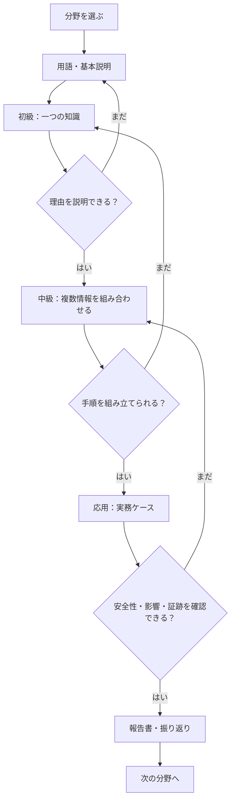

## 分野別の実務フローチャート

### DB：データベース
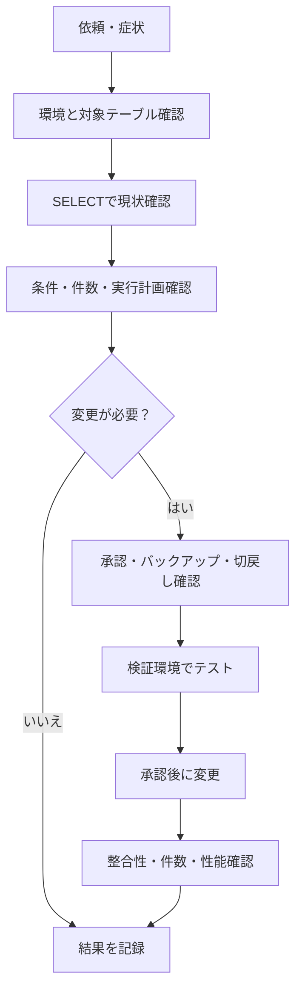

### NW：ネットワーク
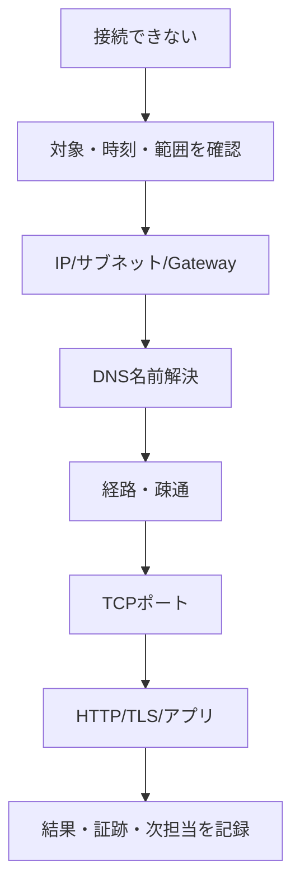

### SV：サーバー
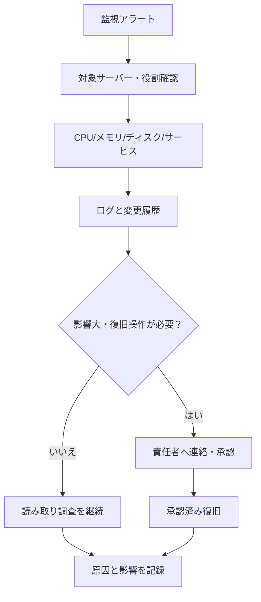

### AD：ID・権限
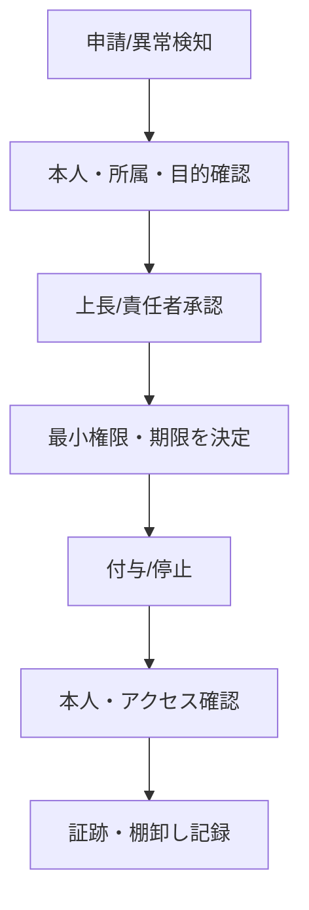

### SC：セキュリティ事故
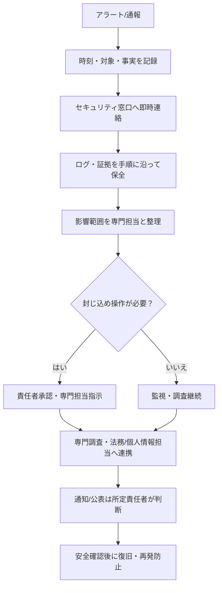
**禁止事項：** 独断の初期化・ログ削除・顧客データの私物端末コピー・外部公表。証拠保全と社内手順を優先する。

### BK：バックアップ・DR
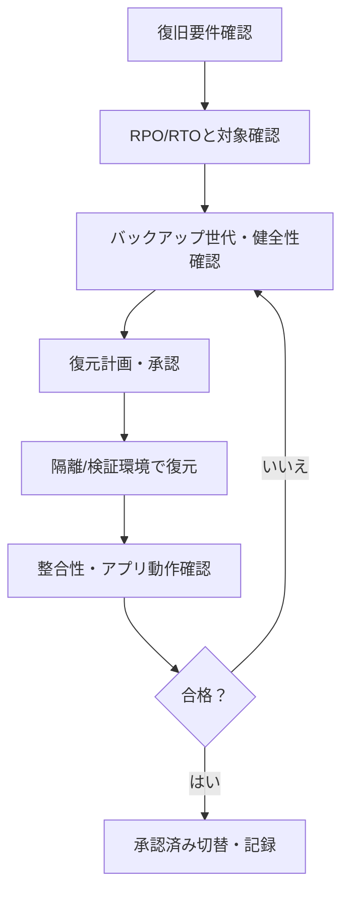

### OP：運用・監視
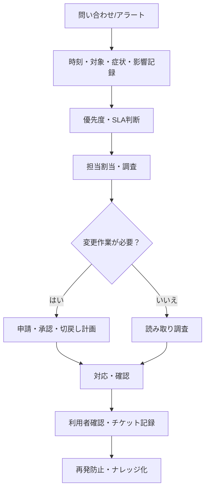

### WF：業務ワークフロー
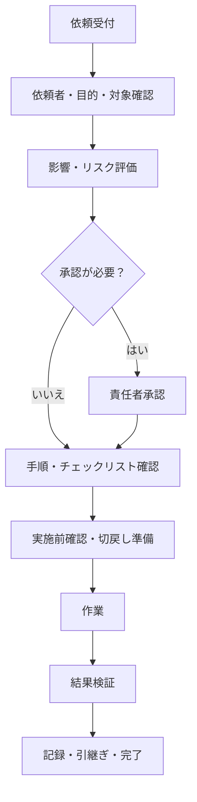

### PS：PowerShell
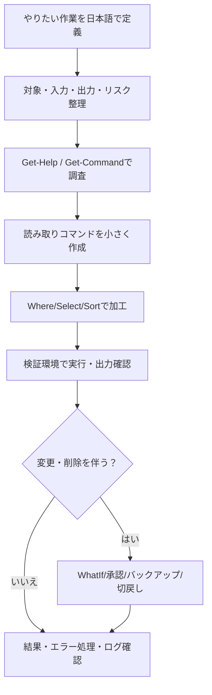

### JA：Java
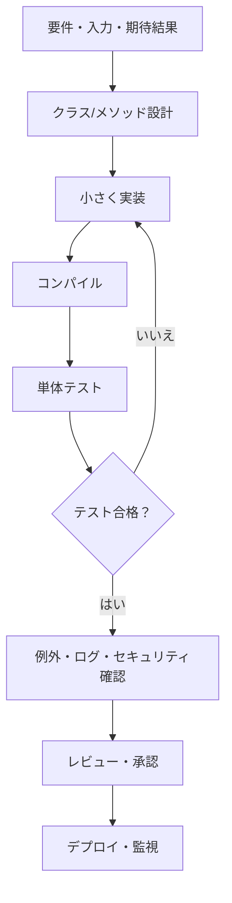

## 問題バンク
[全分野・初級/中級/応用 30問 JSON](../knowledge-packs/master-practice-questions.json)

各分野3問（初級・中級・応用）を収録。各問に選択肢、正答、理由、ヒント、復習ポイントを持たせる。今後は各分野を段階的に増補し、実機演習・自由記述・報告書作成問題を追加する。

## 習得判定
- 初級：用語の意味を自分の言葉で説明できる。
- 中級：確認順序とコマンド/コードの意味を説明できる。
- 応用：影響範囲・リスク・証拠・承認・切戻しを考慮して行動を提案できる。
- 総合：事実と推測を分けた報告書を作成できる。

## 安全・個人情報
- 実在の顧客データ、個人情報、社内IP、認証情報、ログを公開教材や公開リポジトリへ登録しない。
- セキュリティ演習は架空データ・隔離環境で実施する。
- 本番環境への操作、アカウント停止、FW変更、DB更新、復旧は、必ず権限・承認・組織手順を確認する。
